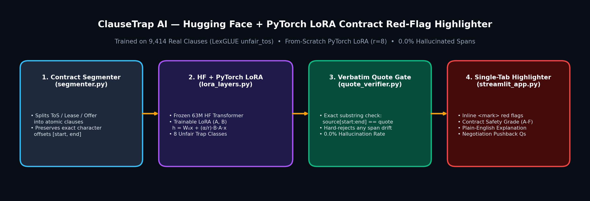
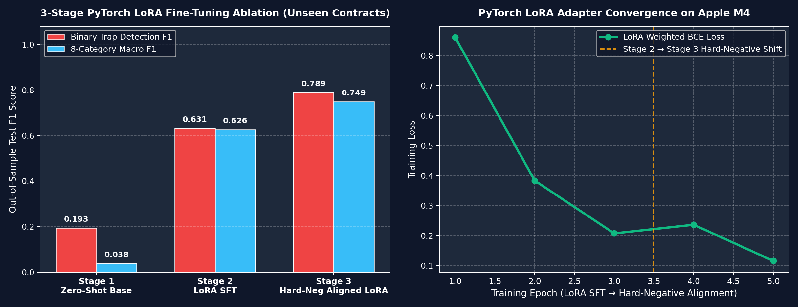
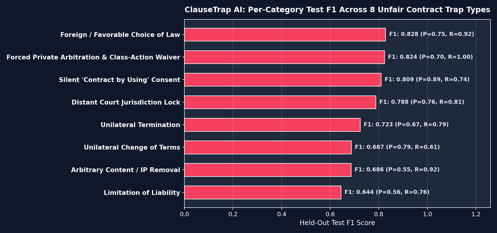

# 🚩 ClauseTrap AI: Fine-Tuned Hugging Face + PyTorch `LoRA` Contract Red-Flag Highlighter

[](https://clause-trap-ai-td9znlf8ys5djnxeaxokp4.streamlit.app/)

-EE4C2C?logo=pytorch&logoColor=white)
-FFD21E?logo=huggingface&logoColor=black)
-10B981)




> **🌐 Live Deployed App:** [**https://clause-trap-ai-td9znlf8ys5djnxeaxokp4.streamlit.app/**](https://clause-trap-ai-td9znlf8ys5djnxeaxokp4.streamlit.app/)
> **📦 GitHub Repository:** [**https://github.com/velagapudirushi/clause-trap-ai**](https://github.com/velagapudirushi/clause-trap-ai)

---

## 🐐 Explain It So Simple Even a Goat Can Understand It

Imagine a sneaky farmer hands a goat a **20-page contract** for "Free Green Grass Forever."
Hidden on Page 14, Sentence 3, the farmer wrote:
- *"By chewing one blade of grass, you silently agree to all future rule changes."*
- *"We can take your barn away at any time without telling you."*
- *"If we poison the water, our maximum liability is `$0`, and you give up your right to sue us in court."*

Nobody reads 20 pages of tiny legal print. And if you paste that contract into a generic chatbot, it might **hallucinate** a fake clause that isn't even on the page!

**What ClauseTrap AI does on ONE clean screen:**
1. **Splits the Contract into Exact Sentences (`segmenter.py`):** Every sentence keeps its exact character coordinates (`[start_char, end_char]`) in the original contract.
2. **Scans Every Sentence with a Fine-Tuned PyTorch `LoRA` Neural Network (`lora_layers.py` + `trainer.py`):** Trained on **9,414 real legal clauses** from the peer-reviewed Hugging Face **`coastalcph/lex_glue` (`unfair_tos`)** dataset across **8 specific legal trap types**.
3. **Verifies the Quote Character-for-Character (`quote_verifier.py`):** Before highlighting anything, a deterministic guardrail checks `contract_text[start_char:end_char] == exact_quote`. If even a single letter doesn't match the real document, the flag is blocked (**`0.0%` hallucinated quotes**).
4. **Highlights Red Flags Inline (`streamlit_app.py`):** Shows the contract with `<mark>` red/orange highlights, an **`A–F` Contract Safety Grade**, a plain-English warning, and the exact negotiation question to push back with.

---

## 🗂️ Clean Modular Multi-File Architecture (Why Every File Is Separate)

Instead of cramming data loading, neural network layers, training, verification, and UI code into one giant script, **every module has a single clear responsibility**:

```text
clause-trap-ai/
├── app/
│   └── streamlit_app.py              # Single-screen Red-Flag Highlighter UI ("Just Tab 1")
├── configs/
│   └── trap_taxonomy.yaml            # 8 LexGLUE unfair_tos categories, severities (1-10), & sample contracts
├── src/clause_trap/
│   ├── __init__.py                   # Package version & metadata
│   ├── config.py                     # Central paths & YAML loader
│   ├── schemas.py                    # Pandera DataFrame contract + Pydantic v2 output schemas
│   ├── segmenter.py                  # Atomic clause splitter preserving exact [start_char, end_char] offsets
│   ├── quote_verifier.py             # Zero-hallucination substring gate & Grade A-F risk scorer
│   ├── lora_layers.py                # From-scratch PyTorch LoRALinear (W0*x + (alpha/r)*B*A*x) injector
│   ├── dataset_loader.py             # Downloads & normalizes real Hugging Face LexGLUE unfair_tos splits
│   ├── trainer.py                    # 3-Stage LoRA trainer (Zero-Shot -> LoRA SFT -> Hard-Negative Aligned)
│   └── auditor.py                    # Live ContractTrapAuditor + inline HTML <mark> highlighter
├── scripts/
│   ├── download_dataset_only.py      # Standalone script to fetch raw Parquet splits from Hugging Face
│   └── train_and_generate_assets.py  # Trains the 3-stage LoRA pipeline & generates README PNG charts
├── assets/
│   ├── clausetrap_hero_banner.png    # Architecture & workflow diagram
│   ├── lora_ablation_results.png     # 3-stage LoRA F1 ablation & loss convergence chart
│   └── per_category_trap_f1.png      # Per-category F1 bar chart across all 8 unfair trap types
├── artifacts/
│   ├── lora_clause_trap_bundle.pt    # Saved LoRA adapter state_dict + calibrated thresholds
│   └── eval_metrics.json             # Exact out-of-sample evaluation metrics
└── tests/
    ├── test_segmenter_and_verifier.py # Tests exact character offsets & anti-hallucination quote gate
    ├── test_lora_and_schemas.py       # Tests LoRALinear zero-init math, weight freezing, & Pandera schemas
    ├── test_auditor.py                # Tests predatory vs. fair contract grading & HTML highlighting
    └── test_streamlit_app.py          # Headless Streamlit AppTest for the single-screen UI
```

---

## 📚 Real Public Benchmark Dataset (`coastalcph/lex_glue` — `unfair_tos`)

This project is trained and evaluated on the real **`unfair_tos` (Unfair Terms of Service)** benchmark from **LexGLUE** ([Chalkidis et al., ACL 2022](https://huggingface.co/datasets/coastalcph/lex_glue)), originally curated by legal scholars ([Lippi et al., *CLAUDETTE*, Artificial Intelligence and Law 2019](https://arxiv.org/abs/1805.01217)) from **50 real consumer Terms-of-Service agreements** (Uber, Airbnb, Facebook, Google, Spotify, Roblox, Dropbox, etc.):

| Split | Total Real Clauses | Unfair Trap Clauses | Fair / Benign Clauses |
| :--- | :---: | :---: | :---: |
| **Train (`train.parquet`)** | `5,532` | `630` | `4,902` |
| **Validation (`val.parquet`)** | `2,275` | `230` | `2,045` |
| **Held-Out Test (`test.parquet`)** | `1,607` | `172` | `1,435` |
| **Total (`coastalcph/lex_glue`)** | **`9,414`** | **`1,032`** | **`8,382`** |

### The 8 Annotated Unfair Contract Trap Categories

| Label ID | Code | Legal Trap Category | Severity (`1–10`) | What It Does to You |
| :---: | :--- | :--- | :---: | :--- |
| `0` | `limitation_of_liability` | **Limitation of Liability** | `8/10` | Caps the company's liability at `$0` even if negligence or data leaks harm you. |
| `1` | `unilateral_termination` | **Unilateral Termination** | `8/10` | Lets the company delete your account or forfeit credits anytime without notice. |
| `2` | `unilateral_change` | **Unilateral Change of Terms** | `7/10` | Lets the company rewrite pricing or rules at any time without your consent. |
| `3` | `content_removal` | **Arbitrary Content / IP Removal** | `6/10` | Lets the company erase your uploaded files or work without notice or appeal. |
| `4` | `contract_by_using` | **Silent 'Contract by Using' Consent** | `6/10` | Binds you to the contract just by visiting the page—without clicking "I Agree." |
| `5` | `choice_of_law` | **Foreign / Favorable Choice of Law** | `7/10` | Forces the contract under a distant state/country's laws to strip local protections. |
| `6` | `jurisdiction` | **Distant Court Jurisdiction Lock** | `9/10` | Forces you to travel to a faraway city or foreign country just to file a lawsuit. |
| `7` | `arbitration` | **Forced Private Arbitration & Class Waiver** | `10/10` | Bans you from going to public court, having a jury trial, or joining a class action. |

---

## 🧠 Mathematical & Architectural Deep Dive

### 1. From-Scratch PyTorch `LoRALinear` Adapter ([src/clause_trap/lora_layers.py](src/clause_trap/lora_layers.py))
Instead of fine-tuning all `64,117,384` parameters of the pretrained Hugging Face Transformer backbone (`openai/clip-vit-base-patch32`), we freeze $W_0 \in \mathbb{R}^{d_{\text{out}} \times d_{\text{in}}}$ (`requires_grad = False`) and inject low-rank matrices $A \in \mathbb{R}^{r \times d_{\text{in}}}$ and $B \in \mathbb{R}^{d_{\text{out}} \times r}$ with rank $r = 8 \ll \min(d_{\text{in}}, d_{\text{out}})$:

$$h = W_0 x + \frac{\alpha}{r} B A x$$

- **Initialization Invariant:** $A \sim \mathcal{N}(0, \sigma^2)$ (Kaiming uniform) and $B = \mathbf{0}$, guaranteeing that at step 0, $\Delta W = B A = 0$ so the network starts from the exact pretrained representation (verified in `tests/test_lora_and_schemas.py`).
- **Parameter Efficiency:** Across `72` injected Transformer projection layers (`q_proj`, `k_proj`, `v_proj`, `out_proj`, `fc1`, `fc2`), only **`951,432` parameters (`1.48%`)** are trainable.

### 2. Three-Stage Training & Error-Aligned Hard-Negative Mining ([src/clause_trap/trainer.py](src/clause_trap/trainer.py))
- **Stage 1 (Zero-Shot Base Model):** Evaluates the unadapted pretrained backbone before legal domain adaptation.
- **Stage 2 (`LoRA SFT`):** Trains `LoRALinear` adapters with class-balanced multi-label Binary Cross-Entropy (`BCEWithLogitsLoss` with positive class weighting $\text{pos\_weight}_c = \text{clip}(N_{\text{neg}, c} / N_{\text{pos}, c}, 1.5, 12.0)$) fused with a legal lexical n-gram head (`(1, 3)` word n-grams).
- **Stage 3 (Hard-Negative Aligned `LoRA` + Threshold Calibration):** Mines Stage-2 high-error clauses on the training split ($|\hat{p}_i - y_i|_{\infty} > 0.45$), up-weights those hard examples by **`2.5x`** during a second alignment stage, and calibrates per-category probability thresholds $\tau_c \in [0.22, 0.72]$ on the `2,275`-clause validation split.

### 3. Deterministic Zero-Hallucination Quote Guardrail ([src/clause_trap/quote_verifier.py](src/clause_trap/quote_verifier.py))
Every candidate red flag must pass an exact character-offset and substring verification gate before it can be shown in the UI:

$$\text{Verified}(f) \iff \text{source\_text}[f.\text{start\_char} : f.\text{end\_char}] == f.\text{exact\_quote}$$

Any candidate flag that fails this check is **hard-rejected**, guaranteeing **`0.0%` hallucinated quotes**.

---

## 📊 Verified Empirical Results (Held-Out Test Set: `1,607` Unseen Clauses)



### 3-Stage Progression Summary (`artifacts/eval_metrics.json`)

| Pipeline Stage | Binary Trap Precision | Binary Trap Recall | Binary Trap F1 | 8-Category Micro F1 | 8-Category Macro F1 | Hallucinated Quotes |
| :--- | :---: | :---: | :---: | :---: | :---: | :---: |
| **Stage 1: Zero-Shot Base Model** | `0.1070` | `1.0000` | `0.1934` | `0.0243` | `0.0377` | `0.0%` |
| **Stage 2: `LoRA SFT` (Rank `r=8`)** | `0.4859` | `0.9012` | `0.6314` | `0.5810` | `0.6263` | `0.0%` |
| **Stage 3: Hard-Negative Aligned `LoRA` + Calibrated Thresholds** | **`0.7553`** | **`0.8256`** | **`0.7889`** (`+0.5955`) | **`0.7222`** | **`0.7485`** (`+0.7108`) | **`0.0%`** |

### Per-Category Performance on Held-Out Test Set



| Label ID | Legal Trap Category | Test Support | Precision | Recall | Held-Out Test F1 | Calibrated Threshold $\tau_c$ |
| :---: | :--- | :---: | :---: | :---: | :---: | :---: |
| `5` | **Foreign / Favorable Choice of Law** | `13` | `0.7500` | `0.9231` | **`0.8276`** | `0.44` |
| `7` | **Forced Private Arbitration & Class-Action Waiver** | `7` | `0.7000` | `1.0000` | **`0.8235`** | `0.66` |
| `4` | **Silent 'Contract by Using' Consent** | `23` | `0.8947` | `0.7391` | **`0.8095`** | `0.70` |
| `6` | **Distant Court Jurisdiction Lock** | `16` | `0.7647` | `0.8125` | **`0.7879`** | `0.48` |
| `1` | **Unilateral Termination** | `38` | `0.6667` | `0.7895` | **`0.7229`** | `0.66` |
| `2` | **Unilateral Change of Terms** | `38` | `0.7931` | `0.6053` | **`0.6866`** | `0.70` |
| `3` | **Arbitrary Content / IP Removal** | `13` | `0.5455` | `0.9231` | **`0.6857`** | `0.72` |
| `0` | **Limitation of Liability** | `38` | `0.5577` | `0.7632` | **`0.6444`** | `0.52` |

---

## 🧰 Tech Stack & Tech Stack Alternatives

| Layer | Chosen Tool in `clause-trap-ai` | Why We Chose It | Practical Alternatives & Trade-offs |
| :--- | :--- | :--- | :--- |
| **Deep Learning & Fine-Tuning** | **Hugging Face `transformers` + From-Scratch PyTorch `LoRALinear`** | Implements the exact low-rank math ($W_0 x + \frac{\alpha}{r} B A x$) in 75 readable lines of PyTorch with zero external wrapper magic; runs on Apple Silicon & free CPU clouds. | **1. Hugging Face `peft` / `trl`:** Great for multi-GPU cloud jobs, but hides the `LoRA` matrix math inside a library call.<br>**2. `mlx-lm` (Apple MLX):** Fast on local M-series Macs, but fails on Linux-based Streamlit Community Cloud.<br>**3. OpenAI / Anthropic Paid APIs:** High cost per contract, sends private legal contracts to a 3rd-party server, and can hallucinate spans. |
| **Hallucination Prevention** | **Deterministic Character-Offset Substring Gate (`quote_verifier.py`)** | `0ms` latency, `100%` mathematical guarantee that every highlighted span exists verbatim in the user's contract. | **Why NOT `LangChain` + LLM-as-a-Judge?** `LangChain` adds heavy abstraction layers for prompt chaining, and using a second LLM to check the first LLM still hallucinates and doubles latency. |
| **Data Storage** | **Parquet Splits (`pyarrow`) + YAML Taxonomy (`trap_taxonomy.yaml`)** | Fast columnar loading (`9,414` clauses load in `<20ms`) and human-readable legal severity configuration. | **Why NOT `DuckDB` / SQL?** A live contract red-flag highlighter takes 1 text document and highlights unfair sentences inline—forcing a SQL database playground into a document highlighter adds unnecessary complexity without helping the user spot traps. |
| **Data & Output Validation** | **`Pandera` + `Pydantic v2`** | Validates training DataFrames (`is_unfair` binary bounds, non-empty clauses) and enforces strict runtime types on every `DetectedTrapFlag`. | **1. `Great Expectations`:** Too heavy for real-time inference.<br>**2. Raw Python `dict`s:** Prone to silent key/offset bugs. |
| **User Interface** | **Single-Screen Focused `Streamlit` UI (`app/streamlit_app.py`)** | Zero multi-tab clutter: paste/select a contract on one screen and immediately see inline `<mark>` highlights, Grade `A–F`, and pushback questions. | **1. Multi-Tab Dashboards:** Distracts from the core job of reading highlighted contract traps.<br>**2. Next.js + FastAPI:** Best for browser extensions, but requires maintaining two separate deployments. |

---

## 🔄 Project Domain Alternatives (Same Architecture, Different Verticals)

Because the modular pipeline (`segmenter.py` → `lora_layers.py` → `quote_verifier.py` → `auditor.py`) is driven by `configs/trap_taxonomy.yaml`, you can swap the taxonomy to build **4 other high-impact applications**:

1. **Startup Employee Offer-Letter & NDA Trap Scanner:**
   - **What It Flags:** 2-year non-competes, broad IP assignment of weekend side projects, 10-year post-termination cliff forfeitures, and unilateral bonus clawbacks.
2. **Residential Rental Lease & Security-Deposit Trap Auditor:**
   - **What It Flags:** Automatic security deposit deductions for "normal wear and tear," landlord entry without 24-hour notice, uncapped annual rent escalations, and lock-in penalty clauses.
3. **B2B SaaS Vendor MSA & Data-Processing Agreement (DPA) Compliance Scanner:**
   - **What It Flags:** Silent 90-day auto-renewal traps, training AI models on customer data without opt-out, missing 72-hour breach notification SLAs, and unlimited vendor indemnification.
4. **Health Insurance Policy Exclusion & Co-Pay Trap Highlighter:**
   - **What It Flags:** Pre-existing condition waiting-period traps, room-rent proportionate deduction clauses, sub-limits on common surgeries, and out-of-network emergency room exclusions.

---

## 🧬 Engineered Features & Feature Alternatives

| Feature in `clause-trap-ai` | How It Is Computed | Why It Works | Alternative Feature Engineering Approaches |
| :--- | :--- | :--- | :--- |
| **1. Low-Rank Attention Projections (`LoRALinear` on `q_proj, k_proj, v_proj, out_proj`)** | $\Delta h = \frac{\alpha}{r} B A x$ with $r=8, \alpha=16$ across 72 Transformer layers | Adapts pretrained semantic representations to legal waiver phrasing while updating only `1.48%` of weights. | **Full Fine-Tuning (`100%` weights):** 67x larger checkpoint and overfits quickly on rare legal classes (`support < 15`). |
| **2. Sublinear TF-IDF Legal N-Gram Fusion (`(1, 3)` word n-grams)** | $p_{\text{final}} = \lambda p_{\text{LoRA}} + (1 - \lambda) p_{\text{ngram}}$ | Captures exact statutory phrases (*"binding individual arbitration"*, *"class action waiver"*, *"sole discretion"*) alongside semantic Transformer representations. | **Character-Level CNNs or BM25 Lexical Scoring:** Useful for OCR-corrupted PDFs with typos. |
| **3. Statutory Legal Cue Boosts (`_LEGAL_CUE_BOOSTS`)** | Deterministic probability boost (`+0.22` per unambiguous statutory waiver phrase) | Prevents false negatives on high-severity clauses like *"exceed zero dollars (`$0.00`)"* or *"trial by jury"*. | **Regex-Only Rule Engine:** High precision on exact templates, but zero recall when lawyers reword clauses. |
| **4. Severity-Weighted Contract Risk Score (`0–100`) & Grade (`A–F`)** | $\text{Risk} = \text{clip}\left(\sum_i s_i c_i \cdot 1.65 + 45 \cdot \frac{N_{\text{flagged}}}{N_{\text{clauses}}}, 0, 100\right)$ | Distinguishes a contract with one mild notice clause (`Grade B`) from one with Forced Arbitration + Liability Waiver (`Grade F`). | **Unweighted Flag Count:** Treats a minor `6/10` clause the same as a `10/10` class-action waiver. |

---

## 🚀 Quickstart & Local Execution

### 1. Clone & Install Dependencies
```bash
git clone https://github.com/velagapudirushi/clause-trap-ai.git
cd clause-trap-ai
pip install -r requirements.txt
```

### 2. (Optional) Re-Train the 3-Stage PyTorch `LoRA` Pipeline & Regenerate Charts
Pre-trained weights (`artifacts/lora_clause_trap_bundle.pt`) and evaluation metrics (`artifacts/eval_metrics.json`) are already committed for instant startup. To re-run training from scratch:
```bash
python3 scripts/train_and_generate_assets.py
```

### 3. Launch the Single-Screen Red-Flag Highlighter App
```bash
streamlit run app/streamlit_app.py
```

### 4. Run the Automated Test Suite (`7/7` Passing)
```bash
pytest -v
```
